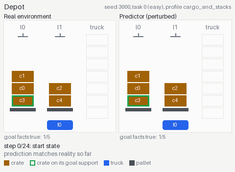
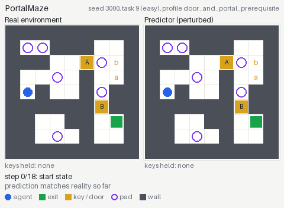
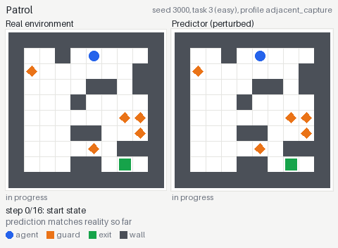
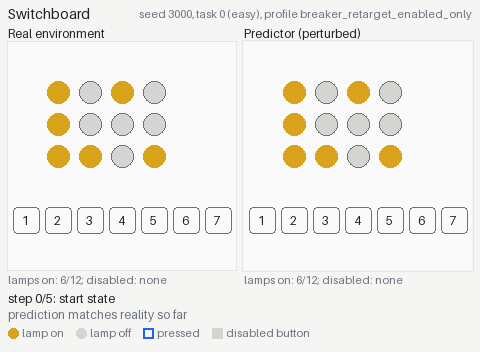
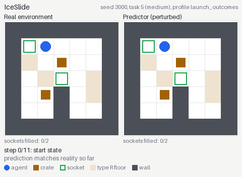
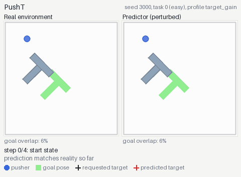

# World-Adapt

World-Adapt measures whether a language-model agent can learn, from its own experience, where a predictive tool is wrong.
The agent solves a sequence of planning tasks in a small simulated world.
Before it acts, it can ask a predictor what a sequence of actions would do.
In half of the conditions that predictor has a fixed, systematic error.
Between tasks the agent keeps a short notebook, and the benchmark compares histories where the notebook is saved with histories where it is wiped.

<table>
  <tr>
    <td align="center"><br>Depot</td>
    <td align="center"><br>PortalMaze</td>
    <td align="center"><br>Patrol</td>
  </tr>
  <tr>
    <td align="center"><br>Switchboard</td>
    <td align="center"><br>IceSlide</td>
    <td align="center"><br>PushT</td>
  </tr>
</table>

Each panel pair shows the real environment on the left and the faulty predictor on the right, replaying the same actions.
The red outline marks the first step where the prediction stops matching reality.

## How it works

Each **history** is 14 tasks in one environment: 8 adaptation tasks followed by 6 held-out tasks (two per difficulty tier).
On every task the agent has two tools:

- `predict(actions)` rolls the actions forward in a simulator from the current real state and returns the predicted observations.
  Predictions are hypothetical and never change the real environment.
- `execute(actions)` acts in the real environment, up to 8 actions per call.

The agent receives the goal, a text observation, and a short statement of the true rules.
Hidden task details, such as where portals lead or which lamps a button toggles, are never shown.
The real action budget is three times the reference solution length (at least 10, and 40 for PushT), and the prediction budget is twice that.

After each task, a separate writer call updates a notebook of at most 2,000 tokens from the public record of the task: the tool calls, the predictions, and the real observations.
The real environment, the rules, and the predictor stay fixed for the whole history, so anything learned on task 3 still applies on task 13.

Every model runs four conditions in each environment:

| Condition | Predictor | Notebook between tasks |
|---|---|---|
| Accurate predictor + saved notebook | Exact copy of the real dynamics | Carried forward |
| Accurate predictor + reset notebook | Exact copy of the real dynamics | Empty at every task |
| Faulty predictor + saved notebook | Real dynamics plus a fixed perturbation | Carried forward |
| Faulty predictor + reset notebook | Real dynamics plus a fixed perturbation | Empty at every task |

Saved versus reset shows what accumulated experience is worth.
Faulty versus accurate shows what the predictor's error costs.
The interesting question is whether a saved notebook recovers that cost, and whether it does so because the agent learned where the predictor fails.

## Environments and perturbations

All six environments are deterministic, and every task is generated from a fixed seed with a verified reference solution.
The predictor is not a learned model; it is the environment's own simulator.
The faulty predictor applies the true step and then a small set of perturbation rules, each a condition plus a change to the predicted state.
Because each predicted step starts from the previous predicted state, errors compound over a long prediction.

| Environment | Task | What the faulty predictor gets wrong |
|---|---|---|
| **Depot** | Classic PDDL logistics: drive, lift, drop, load and unload crates into goal stacks. | It claims a truck holds only one crate and that crates cannot be stacked on crates, so legal actions look like they do nothing. |
| **PortalMaze** | Reach the exit of a grid maze with keys, doors, and hidden one-way portals. | Portals send the agent backwards, and a door opens for the wrong key. |
| **Patrol** | Reach the exit without meeting guards that walk hidden back-and-forth routes. | Standing next to a guard is reported as a capture, so safe moves look fatal. |
| **Switchboard** | Turn on every lamp by pressing buttons with hidden wiring; some buttons are breakers that disable another button. | After the first button is disabled, a breaker appears to disable the wrong button. |
| **IceSlide** | Slide around an icy board and launch crates into sockets. | Launched crates stop one cell early, slide past rough tiles, or fail to lock into sockets. |
| **PushT** | Push a T-shaped block onto a goal pose with a circular pusher (pymunk physics). | Every push is predicted to reach only 80% of the way to its target. |

[docs/environments.md](docs/environments.md) describes each environment, its difficulty tiers, and the exact perturbation rules, with a GIF for each.
To regenerate the GIFs, run `uv run --locked python scripts/render_environment_gifs.py`.

## Results

Results from the October 2026 study: nine models, one seed block (3000), 24 histories and 336 tasks per model.
Claude Opus 5.5 ran at high reasoning effort and the other models at low effort.
The table gives the share of held-out tasks solved; each condition cell holds 36 tasks.

| Model | All conditions | Accurate + saved | Accurate + reset | Faulty + saved | Faulty + reset |
|---|---:|---:|---:|---:|---:|
| Claude Opus 5.5 | **97%** | 100% | 94% | 97% | 97% |
| DeepSeek V4.1 Flash | 88% | 94% | 89% | 83% | 83% |
| Kimi K2.6 | 73% | 83% | 67% | 75% | 67% |
| GLM-5.3-Flash | 59% | 72% | 56% | 61% | 47% |
| Gemma 4 31B | 41% | 44% | 42% | 39% | 39% |
| Qwen3.6-35B-A3B | 22% | 33% | 17% | 17% | 22% |
| Nemotron 3 Super | 11% | 11% | 14% | 6% | 14% |
| GPT-OSS-120B | 8% | 8% | 6% | 8% | 8% |
| Inkling | 0% | 0% | 0% | 0% | 0% |

What we take from it (paired over the same tasks, 95% bootstrap intervals over model and environment cells, Inkling excluded because it solves nothing):

- **The faulty predictor costs about five points.**
  Over all 14 tasks it changes success by -5.0 points [-7.3, -2.8], about equally with a saved or a reset notebook.
- **A saved notebook helps only with an accurate predictor.**
  On held-out tasks it adds +7.4 points [+3.2, +11.6] with the accurate predictor and +0.4 [-4.2, +5.2] with the faulty one.
  The difference, -7.0 [-13.6, -1.0], is borderline (permutation p = 0.05).
- **Agents find the error but do not act on it.**
  A three-judge Notebook Judge shows that Opus, DeepSeek, Kimi, and Gemma name or locate the perturbed rule in nearly every faulty-predictor history.
  Weaker models invent errors: Nemotron reports a non-existent predictor error in 10 of its 12 accurate-predictor histories.
- **Push-T is the hardest environment:** five models solve none of its held-out tasks.

Kimi K2.6 has 332 of its 336 tasks scored; four held-out tasks of one Patrol history are missing and count as missing, not as failures.
[results/october-2026](results/october-2026) holds the per-task outcomes and the notebook labels behind every number here.

## Installation

You need Python 3.12 and [uv](https://docs.astral.sh/uv/) on Linux or macOS.
Windows users need WSL2, because the spend ledger uses POSIX file locks.

```bash
git clone https://github.com/zh1kang/world-adapt.git
cd world-adapt
uv sync --locked
```

All six environments run on CPU with no game ROMs or GPUs.
On a headless Linux machine, PushT needs OpenGL and GLib (`apt-get install libgl1 libglib2.0-0`).
On Linux ARM64, `pymunk` builds from source and needs a C compiler (`apt-get install gcc libc6-dev`).

## Quickstart

Copy `.env.example` to `.env.local` and fill in the key for the provider you use.
`.env.local` is ignored by Git.

```bash
cp .env.example .env.local
```

Prepare a small study: one model, one environment, one condition, and a short history.
You supply the provider's current prices in dollars per million tokens and the model's input-token limit; the spend ledger uses them to enforce the budget.

```bash
uv run --locked python -m world_adapt.runner.local prepare \
  --provider sail --model openai/gpt-oss-120b \
  --budget-usd 2 --input-price <input $/M> --output-price <output $/M> --input-limit 131072 \
  --reasoning-effort low \
  --env patrol --condition faulty-predictor-saved-notebook \
  --adaptation-tasks 2 --heldout-per-tier 1 \
  --out outputs/quickstart
```

Check the plan without spending anything, then run it:

```bash
uv run --locked python -m world_adapt.runner.local run --study outputs/quickstart/study.json --dry-run
uv run --locked python -m world_adapt.runner.local run --study outputs/quickstart/study.json
```

Summarize the results:

```bash
uv run --locked python -m world_adapt.runner.analyze --study outputs/quickstart/study.json
```

This writes `summary.md`, `results.json`, `runs.csv`, and `episodes.csv` to `outputs/quickstart/analysis/`.

## Running the full benchmark

Drop the `--env`, `--condition`, `--adaptation-tasks`, and `--heldout-per-tier` flags to prepare the full study for one model: six environments, four conditions, and 14 tasks per history, for 336 tasks.
`prepare` refuses to overwrite an existing directory, so use a new `--out` for each study.

```bash
uv run --locked python -m world_adapt.runner.local prepare \
  --provider sail --model <model id> \
  --budget-usd <budget> --input-price <input $/M> --output-price <output $/M> --input-limit <input limit> \
  --reasoning-effort low \
  --out outputs/my-study
```

Before paying for inference, `preflight` regenerates every task and checks reference solutions, predictor parity with the real environment, and state isolation.
It makes no model calls and takes a few minutes.

```bash
uv run --locked python -m world_adapt.runner.preflight outputs/my-study/study.json --out outputs/my-study/preflight.json
uv run --locked python -m world_adapt.runner.local run --study outputs/my-study/study.json --workers 4
```

`--workers` sets how many histories run at once; keep it within your provider's rate limit.
The prepared directory pins the study manifest, the agent configuration, and a snapshot of the source code with checksums, so the protocol cannot drift while a study runs.
The scientific settings come from [configs/study.json](configs/study.json) and the agent settings from [configs/agents/example.json](configs/agents/example.json).
If you change task counts or budgets, edit a copy of the template, pass it with `--template`, and report the change with your results.

`analyze` reports held-out success per environment and condition, the paired contrasts (saved minus reset under each predictor, and accurate minus faulty under each notebook condition) with bootstrap intervals, and how often the agent used the predictor.
To check a single history without any model calls, `rescore` replays its logged real actions and recomputes its scores:

```bash
uv run --locked python -m world_adapt.runner.rescore outputs/my-study/runs/<run folder>
```

## Providers

| Provider | `--provider` | Credentials in `.env.local` |
|---|---|---|
| [SAIL](https://sailresearch.com) (hosted open-weight models) | `sail` | `SAIL_API_KEY` |
| Any OpenAI-compatible endpoint, such as vLLM on Modal | `modal` | `MODAL_BASE_URL`, `MODAL_API_KEY` |
| Anthropic | `anthropic` | `ANTHROPIC_API_KEY` |

The `modal` provider talks to any OpenAI-compatible server that supports streamed tool calls and reports token usage.
[scripts/modal_vllm.py](scripts/modal_vllm.py) serves Qwen3.6-35B-A3B on one Modal H200 with vLLM and scales to zero when idle:

```bash
uvx modal secret create world-adapt-vllm VLLM_API_KEY=<a random key>
uvx modal deploy scripts/modal_vllm.py
```

Set `MODAL_BASE_URL` to the printed URL followed by `/v1`, set `MODAL_API_KEY` to the same key, and pass `--model qwen3.6-35b-a3b`.
For an endpoint behind Modal proxy auth, also set `MODAL_PROXY_KEY` and `MODAL_PROXY_SECRET`.

## Budgets and recovery

Before each request, the run reserves its cost in a locked spend ledger: twice the estimated prompt size (capped at `--input-limit`) plus the reply cap.
When the reply arrives, the reservation is replaced by the reported usage.
A request the provider rejects outright is released; a request that times out or breaks mid-stream stays reserved, because it may have been billed.
The run pauses cleanly when the next reservation would exceed the budget.
Token prices do not cover GPU time on a self-hosted endpoint; set a separate spending limit with your GPU provider.

Running `local run` again on the same study resumes it.
Finished tasks are never rerun, and interrupted histories continue from their last finished task.
If the study paused because it reached its budget, raise the budget when you resume; the new amount is recorded next to the study and can only go up:

```bash
uv run --locked python -m world_adapt.runner.local run --study outputs/my-study/study.json --budget-usd 40
```

Provider errors are retried with backoff, and a history that crashes is relaunched up to `--max-attempts` times (default 3).
For the `modal` provider, `local run` first waits for the endpoint to answer, up to `--endpoint-timeout` seconds (default 900), because a cold start takes 3 to 10 minutes.
Tasks lost to provider errors are reported as missing, not as model failures.

## Task data

The benchmark's tasks are generated from a seed with verified reference solutions.
[data/tasks/seed-3000.jsonl](data/tasks/seed-3000.jsonl) lists all 84 tasks of the study (14 per environment): the initial observation the agent sees, its SHA-256, the reference solution, and the step budgets.
[data/environments.json](data/environments.json) gives each environment's goal, rules, and actions, and the faulty predictor's rules (evaluator-only; agents never see them).
Every observation hash matches the one recorded in the study's run manifests.
To regenerate both files:

```bash
uv run --locked python scripts/export_tasks.py
```

## Notebook Judge

The Notebook Judge labels what each notebook says about the predictor, checked against the predictor's actual perturbation.
Each judge sees the environment's true rules, the perturbation rules, and the notebook, but not the model or any task outcome.
It records whether the notebook names the perturbed rule, locates the error, only warns vaguely, or says nothing; whether it reports an error that does not exist; what it tells the agent to do with `predict`; and any false statements, with quotes checked against the notebook.
With several judges, the label is the majority, and the output includes Fleiss' and pairwise Cohen's kappa.

```bash
uv run --locked python -m world_adapt.runner.judge --runs outputs/my-study/runs --out outputs/my-study/judge \
  --judge anthropic:claude-opus-5-5 --judge sail:deepseek-ai/DeepSeek-V4.1-Flash --judge sail:moonshotai/Kimi-K3
```

Judgments are cached by notebook, so rerunning after new histories finish only judges the new notebooks.
Anthropic judges use the Batch API by default (`--no-batch` to call synchronously); judging costs real money, so try `--sample 30` first.

## Repository layout

```
world_adapt/
  environments/   the six environments, task generators, and reference solvers
  perturbations/  perturbation rules and the profile used for each environment
  predictors/     the simulator predictor behind the predict tool
  agent/          the agent loop, tools, notebook writer, provider clients, and spend ledger
  runner/         study preparation, scheduling, preflight, analysis, rescoring, and the Notebook Judge
configs/          the study template and an example agent configuration
scripts/          task export, GIF rendering, and the Modal vLLM server
data/             the study's task instances and environment definitions
results/          per-task outcomes and Notebook Judge labels of the October 2026 study
docs/             environment documentation and GIFs
tests/            offline tests with scripted clients; no model calls
```

## Tests

```bash
uv run --locked python -m pytest -q
```

The suite takes about two minutes and makes no network calls.
It covers every environment and its perturbation rules, the predictor, the agent loop with scripted model clients, the provider clients, the spend ledger, scheduling and resume, study preparation, and analysis.
A golden file pins the generated tasks, prompts, and budgets of the full study, so any change to the protocol shows up as a test failure.
